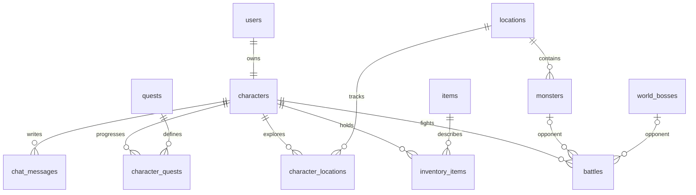

# Архитектура версии 2

FastAPI выдаёт интерфейс и JSON API с одного адреса. Сервер рассчитывает весь бой
одной транзакцией и сохраняет результат до отправки ответа. Браузер воспроизводит
пошаговые кадры: закрытие страницы не отменяет нанесённый урон и награды.

## Данные

12 таблиц: users, characters, locations, monsters, items, inventory_items, quests,
character_quests, battles, world_bosses, chat_messages, character_locations.
Последняя хранит победы, эликсиры и победу над мини-боссом по каждому этапу.
Мини-боссы — разновидность Monster с флагом is_miniboss.

## Конкурентный доступ

Изменения героя сериализуются блокировкой его строки FOR UPDATE. Это относится
к бою, лечению, экипировке, объединению, начислению регенерации и наградам.
Предметы уникальны по персонажу, виду и звёздности; копии хранятся в quantity.
Три копии удаляются/уменьшаются и создают улучшенный предмет одной транзакцией.
При улучшении надетого предмета слот переключается на результат объединения.

Мировой босс дополнительно защищён advisory-блокировкой и блокировкой строки.
Порядок блокировок — герой, затем босс. Два игрока не теряют нанесённый урон,
два запроса не создают несколько новых боссов при возрождении.
UUID боевого запроса уникален для героя. Повтор возвращает сохранённый результат
и не выдаёт добычу заново. Задание можно оплатить один раз.

## Время боя и регенерация

battle_until совпадает с окончанием анимации (0.45 секунды на удар). До этого
момента запрещены новый бой, зелье, смена экипировки, объединение и награда задания.
Это состояние активного боя, а не прежняя задержка между отдельными боями.
Текущий HP и награды уже сохранены. После сбоя браузер получает последний бой
и воспроизводит только оставшиеся кадры. Законченный бой виден в журнале.

hp_updated_at хранит последний расчёт регенерации. Здоровье вычисляется от более
позднего из hp_updated_at и battle_until. Дробная часть сохраняется в БД,
в интерфейсе отображается целое HP. Перед повышением уровня вне боя регенерация
сначала начисляется по старой скорости, чтобы не применять новый бонус задним числом.

## ООП и границы

SQLAlchemy Base — общая база сущностей. AuthService, CombatService,
InventoryService, QuestService и BossService инкапсулируют предметные операции.
Мировой и обычный бой используют один симулятор из balance.py.
Pydantic проверяет запросы; Session передаётся в обработчики через Depends.

Пароли хешируются Argon2, вход хранится в подписанной HttpOnly cookie. Проверяются
JSON и Origin изменяющих запросов, владение предметами, ограничения БД. Чат экранируется.
Ограничение частоты сообщений чата сохранено; ограничения частоты боевых кликов нет.
Для публичного размещения остаются HTTPS, общий лимитер входа, модерация и резервные копии.
