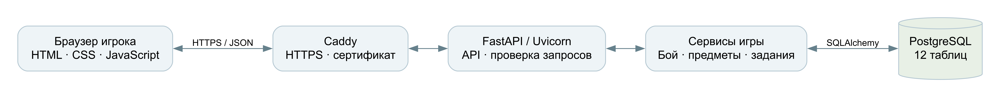
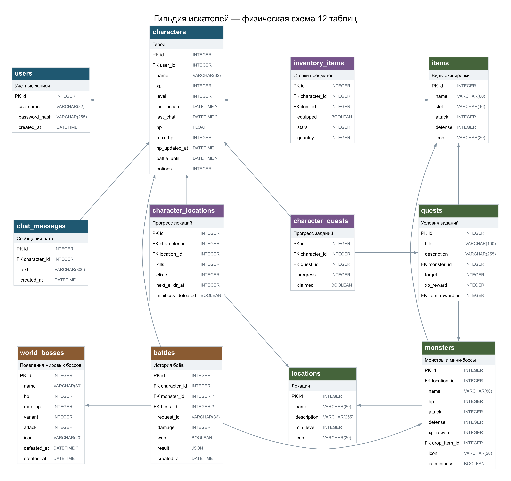

# Гильдия искателей

Подробное руководство по игре и устройству проекта для подготовки к защите

Версия описания: 28 октября 2026 года. Срез исходников: `4c7b280`.
Сайт: https://guild-seekers.online/
Репозиторий: https://github.com/IgorK12345/guild-seekers
Документация API: https://guild-seekers.online/docs

Руководство объясняет реализованную игру, программное устройство и решения, которые нужно уметь обосновать. Сначала прочитайте разделы 1–5, затем разберите свою техническую часть. Перед защитой каждый участник должен сам войти в игру, провести бой и найти в исходниках хотя бы одну операцию своей зоны ответственности.

## 1 Что представляет собой проект

«Гильдия искателей» — учебная многопользовательская браузерная RPG. У каждого аккаунта один герой. Игрок добывает мечи и доспехи, объединяет их в более сильные, увеличивает максимальное здоровье и последовательно открывает три локации. Совместная часть состоит из мирового босса с общим здоровьем, общего чата и рейтинга героев.

Цель игрока — подготовить героя к мини-боссу текущей локации, победить его и перейти дальше. После прохождения трёх этапов можно продолжать улучшать вещи, собирать дополнительные эликсиры и участвовать в атаках на мировых боссов.

Задача приложения — организовать совместную игру нескольких пользователей с сохранением прогресса и едиными правилами. Сервер хранит состояние и проверяет действия, поэтому игроки могут пользоваться разными устройствами и возвращаться позже.

По масштабу это небольшая многопользовательская веб-игра. Здесь нет открытого трёхмерного мира, перемещения персонажей в реальном времени и подтверждённой нагрузки на тысячи игроков. На защите корректнее говорить об учебной многопользовательской RPG, не обещая масштаб коммерческой MMO.

Основные сценарии: регистрация и вход; автоматические сражения; сбор и улучшение экипировки; лечение и регенерация; выполнение заданий; открытие локаций; атаки на мирового босса; общение и просмотр рейтинга.

## 2 Правила игры и игровой цикл

### 2.1 Создание героя

Логин содержит от 3 до 32 латинских букв, цифр или символов подчёркивания. Сервер приводит его к нижнему регистру. Пароль — от 8 до 128 символов. Имя героя — от 2 до 32 символов, допускает кириллицу.

Новый герой получает 60 максимального и текущего HP, базовую атаку 4, базовую защиту 0, первый уровень и учебный меч с бонусом атаки 2. Поэтому итоговая атака нового героя равна 6. Лечебных зелий на старте нет. Три задания добавляются сразу, но нужные противники доступны по мере открытия локаций.

Главный цикл: выбрать противника → провести бой → получить опыт и добычу → надеть или улучшить вещи → восстановить здоровье → победить мини-босса → открыть следующий этап.

### 2.2 Локации и противники

| Локация | Обычные противники | HP каждого | Атака | Опыт | Мини-босс |
|---|---|---:|---:|---:|---|
| Тихий лес | Слизень и волк | 24 | 6 | 30 | Хранитель чащи |
| Забытые руины | Страж и голем | 48 | 14 | 60 | Железный смотритель |
| Пепельные горы | Дух и виверна | 90 | 22 | 90 | Сердце вулкана |

У всех противников текущей версии защита равна нулю, хотя модель и формула позволяют задать её. Лес доступен сразу. Для открытия руин нужно победить Хранителя чащи, для открытия гор — Железного смотрителя. Уровень сам по себе не открывает локацию.

Первый противник каждой пары даёт оружие текущего этапа, второй — доспех. Поэтому игрок выбирает, какой слот ему нужно улучшить.

### 2.3 Автоматический бой

После нажатия «В бой» сервер рассчитывает всю последовательность ударов. Герой атакует первым. Если противник выжил, он отвечает. Обмен повторяется до смерти одной из сторон. Отступить нельзя; лечиться и менять экипировку в активном бою нельзя.

Урон = максимум из 1 и разности атаки нападающего и защиты цели. Фактически нанесённый урон не превышает оставшееся HP цели. Убитый противник не отвечает. Случайных критических попаданий, шкалы точности и разброса урона в текущей версии нет.

Пример первого боя: герой имеет 60 HP и атаку 6, слизень — 24 HP и атаку 6. Герой наносит четыре удара по 6; слизень отвечает три раза. Герой побеждает с 42 HP, получает 30 опыта и лесной клинок с одной звездой. Зелье выпадает отдельно с вероятностью 15%.

Браузер показывает кадры расчёта: выпад атакующего, вспышка на цели, число урона и изменение полосы здоровья. На удар выделено 0,45 секунды. В примере семь кадров, поэтому анимация длится около 3,15 секунды.

Сервер сохраняет итог до отправки ответа. Закрытие страницы не отменяет поражение и не возвращает здоровье. Поле `battle_until` не позволяет начать другой бой или выпить зелье до окончания последовательности. Это время активного боя, а не отдельная задержка между боями.

### 2.4 Постоянное здоровье

HP не заполняется после боя. При поражении герой остаётся с 0 HP, но сохраняет опыт и вещи. Чтобы сражаться снова, нужно восстановить хотя бы 1 целое HP: подождать или выпить лечебное зелье.

HP хранится в БД дробным числом, чтобы учитывать небольшие порции регенерации. Интерфейс и начало боя округляют его вниз до целого. Атаку и защиту повышают вещи, максимальное здоровье — постоянные эликсиры.

### 2.5 Два вида зелий

| Вид | Как получить | Эффект | Ограничение |
|---|---|---|---|
| Зелье лечения | Шанс 15% после обычной победы | До 30% максимального HP, округление вверх | Только вне боя; расходуется |
| Эликсир жизненной силы | Порог побед в своей локации | Сразу +10 максимального и текущего HP | До пяти на локацию |

Лечебные зелья складываются в `characters.potions`. Шанс 15% означает среднюю частоту, а не гарантию после определённого числа побед. Иногда приходится ждать регенерации.

Постоянные эликсиры автоматически применяются при получении. Первые четыре выпадают с интервалами от 3 до 5 побед. После четвёртого следующий интервал — от 6 до 10 побед. Порог хранится в `character_locations.next_elixir_at`: игрок не может бесконечно оставаться без эликсира из-за невезения.

Девять мечей и девять доспехов требуют 18 побед. Расчёт 10 000 последовательностей интервалов дал около 3,94 эликсира к этому моменту; пятый — в среднем к 24-й победе. Это статистическая оценка, конкретное выпадение отличается.

### 2.6 Экипировка и звёзды

На локации есть один вид оружия и один вид доспеха, отдельно существует учебный меч. Обычная победа гарантированно даёт одну копию соответствующего предмета с одной звездой. Мини-боссы и мировые боссы такую вещь не выдают.

Три одинаковые копии одной звёздности превращаются в одну следующей. Операция гарантированная, максимум — пять звёзд. Разные виды и звёздности не смешиваются. Одна карточка инвентаря соответствует паре «вид предмета + звёздность» и показывает количество копий.

| Звёзды | Копий исходной вещи | Множитель базового бонуса |
|---|---:|---:|
| 1 | 1 | 1 |
| 2 | 3 | 1,5 |
| 3 | 9 | 2,25 |
| 4 | 27 | 3,375 |
| 5 | 81 | 5,0625 |

Бонус округляется по формуле `floor(бонус × множитель + 0.5)`. Атака героя — 4 плюс бонус меча, защита — бонус доспеха. Одновременно надет один предмет каждого слота. При объединении надетой стопки улучшенный результат автоматически надевается.

| Предмет | Бонус 1 звезды | Бонус 3 звёзд |
|---|---:|---:|
| Учебный меч | +2 атаки | +5 атаки |
| Лесной клинок | +8 атаки | +18 атаки |
| Кожаный доспех | +4 защиты | +9 защиты |
| Меч стража | +12 атаки | +27 атаки |
| Стальной доспех | +6 защиты | +14 защиты |
| Клинок пламени | +18 атаки | +41 атаки |
| Обсидиановый доспех | +9 защиты | +20 защиты |

Предмет следующей локации с одной звездой равен предыдущему с двумя звёздами. Старая экипировка не становится бесполезной сразу, но дальнейшие улучшения новых вещей выгоднее.

### 2.7 Уровни и регенерация

Уровень не увеличивает атаку, защиту или максимальное HP. Он ускоряет только регенерацию. Для перехода с уровня L требуется `300 × L` дополнительного опыта. Общий опыт к началу уровня L: `150 × (L − 1) × L`.

| Текущий уровень | Опыт до следующего | Общий опыт для следующего |
|---|---:|---:|
| 1 | 300 | 300 |
| 2 | 600 | 900 |
| 3 | 900 | 1800 |
| 4 | 1200 | 3000 |

Монстры этапов дают 30, 60 и 90 XP: на соответствующем уровне ориентир — десять обычных побед без бонусов. Задания и боссы дополнительно ускоряют развитие. Если бить слабых монстров старой локации, понадобится больше десяти побед.

Регенерация в секунду = `max_hp × 0.001 × (1 + 0.1 × (level − 1))`. На первом уровне это 1% максимального HP за 10 секунд, на пятом — 1,4%, на десятом — 1,9%.

Для героя с 60 максимального HP на первом уровне скорость — 0,06 HP в секунду. Примерно через 17 секунд после поражения появится первое целое HP. Зелье позволяет вернуться быстрее.

Постоянного серверного таймера нет. При запросе сервер смотрит на `hp_updated_at`, исключает время активного боя, умножает прошедшие секунды на скорость и ограничивает HP максимумом. Поэтому восстановление учитывается и при закрытой игре. Браузер обновляется каждые пять секунд, когда вкладка активна и не идёт анимация.

### 2.8 Мини-боссы и мировой босс

Мини-босс рассчитывается тем же симулятором, что обычный монстр. Первая победа отмечается в личном прогрессе. Повторная атака уже побеждённого мини-босса отклоняется. Третий завершает прохождение, четвёртой локации нет.

| Мини-босс | HP | Атака | Нужный комплект | HP героя | Остаток при победе |
|---|---:|---:|---|---:|---:|
| Хранитель чащи | 110 | 33 | Лес, 3 звезды | 100 | 4 |
| Железный смотритель | 186 | 41 | Руины, 3 звезды | 140 | 5 |
| Сердце вулкана | 270 | 55 | Горы, 3 звезды | 180 | 5 |

Расчёт предполагает полное HP, меч и доспех своего этапа. Нужно 4/8/12 эликсиров суммарно. С одним эликсиром меньше такой комплект проигрывает. Это баланс, не запрет на попытку: вещи с четырьмя и пятью звёздами дают запас. Все эликсиры равноценны, поэтому 4+4 и 5+3 на втором этапе дают одинаковый максимум HP.

Мировой босс общий для всех. За нажатие — удар героя и ответ выжившего босса, затем можно лечиться. Убивший удар не вызывает ответ. Опыт равен половине фактически нанесённого урона с округлением вниз, минимум 1 XP.

| Мировой босс | Максимальное HP | Атака |
|---|---:|---:|
| Эребус, древний дракон | 5000 | 24 |
| Морозный исполин | 5000 | 32 |
| Владыка пепла | 5000 | 40 |

Через минуту после смерти при очередном запросе создаётся следующее появление, по кругу. Фонового планировщика нет. Строка `world_bosses` — конкретное появление, поэтому история разных появлений не смешивается. Показываются десять участников с наибольшим суммарным уроном текущему боссу.

### 2.9 Задания и общение

Задания требуют по три победы над слизнями, костяными стражами и огненными духами; дают 60, 120 и 180 XP. Прогресс растёт автоматически, награда забирается отдельно и один раз. В текущем сервисе награда задания — только опыт.

Общий чат хранит текст, автора и время. Сообщение — от 1 до 300 символов после удаления пробелов по краям. Герой отправляет не чаще одного сообщения в секунду; клиент получает последние 50. Текст экранируется перед вставкой в страницу.

Рейтинг показывает до 20 героев по общему опыту, при равенстве — по ID. Рейтинг и вклад в босса различаются. Для них не нужны отдельные таблицы: списки рассчитываются запросами.

## 3 Стек и назначение технологий

| Технология | Назначение |
|---|---|
| Python 3.13 | Серверные правила, бой и операции с данными |
| FastAPI | HTTP API, маршруты, Depends и описание OpenAPI |
| Uvicorn | ASGI-сервер, принимающий соединения |
| Pydantic и pydantic-settings | Проверка JSON и чтение настроек |
| SQLAlchemy | ORM-модели, запросы, сессии и транзакции |
| psycopg | Драйвер соединения с PostgreSQL |
| PostgreSQL 17 | Данные, связи, ограничения и блокировки |
| Alembic | Версии и изменения схемы БД |
| HTML и CSS | Экраны, адаптивность и анимации |
| JavaScript | fetch, события, обновление разделов, кадры боя |
| Argon2 | Хеширование паролей с солью |
| Starlette SessionMiddleware и itsdangerous | Подписанная cookie входа |
| pytest, TestClient и httpx | Интеграционные проверки API |
| Docker и Compose | Сборка и запуск сервисов |
| Caddy | HTTPS, сертификаты, передача запросов приложению |
| Ubuntu 24.04 и systemd | ОС VPS и ежедневные резервные копии |
| Git и GitHub | История и хранение исходников |

FastAPI упрощает описание API и проверку запросов. PostgreSQL удобен для связанных данных, которые должны меняться согласованно. SQLAlchemy связывает Python-классы с таблицами, Alembic воспроизводит схему на новой установке.

Интерфейс работает без React/Vue и сборщика: для нескольких экранов хватает HTML, CSS и JavaScript. API и интерфейс имеют один домен, поэтому отдельная настройка CORS для двух сайтов не нужна.

Обработчики API синхронные (`def`), как и доступ к БД. FastAPI выполняет их в рабочем пуле потоков. Нельзя утверждать, что все запросы к БД асинхронные только потому, что выбран FastAPI.

## 4 Архитектура и путь запроса



Это модульный монолит: одно приложение FastAPI с моделями, схемами и сервисами. База и Caddy — отдельные контейнеры, но игровая логика не разбита на микросервисы.

Путь данных: браузер → HTTPS/Caddy → Uvicorn/FastAPI → сервис → SQLAlchemy → PostgreSQL → ответ JSON → интерфейс. Статические файлы тоже выдаёт FastAPI.

Пример боя:

1. JavaScript создаёт UUID и отправляет `POST /api/battles` с `monster_id` и `request_id`.
2. Middleware проверяет формат и Origin, Pydantic — ID и UUID.
3. `current_user` получает ID из подписанной cookie. Герой выбирается по пользователю, а не произвольному ID из запроса.
4. Обработчик блокирует строку героя и вызывает `CombatService.fight`.
5. Сервис проверяет повтор, доступность локации, состояние боя и HP, затем вызывает симулятор.
6. В одной транзакции сохраняются HP, опыт, предметы, зелья, прогресс и бой.
7. Браузер получает кадры, итог и время окончания, показывает анимацию.

Клиент не передаёт «я нанёс 1000 урона» и не назначает добычу. Изменение HTML меняет только локальный экран; сервер берёт реальные характеристики из БД.

## 5 Структура исходников

```text
guild-seekers/
  backend/app/
    main.py          API, cookie, middleware, Depends, страницы
    models.py        12 таблиц и ограничения
    schemas.py       Pydantic-схемы запросов
    database.py      Engine, SessionLocal, Base, get_db
    config.py        Настройки из окружения
    services.py      Игровые операции
    balance.py       Формулы и симулятор
    seed.py          Справочники и начальные противники
  backend/migrations/  История Alembic
  frontend/
    index.html       Вход и регистрация
    game.html        Каркас разделов и окно боя
    css/style.css    Оформление и анимации
    js/auth.js       Форма входа
    js/game.js       API, разделы, кадры, опрос данных
  tests/             Проверки на отдельной PostgreSQL
  deploy/            Caddy, бэкапы, инструкции VPS
  docs/              Документация и материалы защиты
  Dockerfile         Сборка приложения
  compose*.yaml      Сервисы и постоянные volumes
  requirements.txt   Версии библиотек
  alembic.ini        Настройки миграций
  Setup.ps1          Установка на Windows
  Start.cmd Stop.cmd Локальный запуск и остановка
  scripts/local.py   Локальная база и процессы
```

`AuthService` создаёт аккаунт и проверяет пароль. `InventoryService` управляет вещами, объединением и лечением. `QuestService` — заданиями. `CombatService` — обычным боем, мини-боссами, повторами и временем. `BossService` — общим боссом и вкладом игроков.

Сессия БД передаётся в сервис явно. ORM-запросы находятся в сервисах; отдельный универсальный слой репозиториев не добавлен.

Во фронтенде `api()` обрабатывает HTTP; `refreshHero()` — героя; функции `load...` — разделы; `action()` — последовательность действий интерфейса; `animateBattle()` — кадры. Меню переключает разделы внутри `game.html`, а не загружает новый HTML на каждый пункт.

## 6 Структура базы данных

12 предметных и связующих таблиц. Техническая `alembic_version` в это число не входит. Схема построена из реальных моделей SQLAlchemy.



### 6.1 Как читать схему

PK — первичный ключ строки. FK — внешний ключ на другую таблицу. Знак `?` означает допустимый NULL. Стрелка идёт от FK к таблице, на которую он ссылается. Уникальность и CHECK перечислены в словаре ниже.

У пользователя один герой по логике приложения, а `characters.user_id` уникален. Сама БД технически допускает пользователя без героя; регистрация создаёт оба объекта одной транзакцией. Это отличие бизнес-правила от одного внешнего ключа.

Связи «многие ко многим» раскрыты через `inventory_items`, `character_quests` и `character_locations`. Эти строки содержат дополнительные данные отношения: количество, звёзды, прогресс и эликсиры.

### users — Учётные записи

Отделяет данные входа от игрового героя.

| Поле | Тип и ключ | Назначение |
|---|---|---|
| id | int · PK | Идентификатор строки. |
| username | VARCHAR(32) | Уникальный логин в нижнем регистре. |
| password_hash | VARCHAR(255) | Хеш Argon2, не открытый пароль. |
| created_at | timestamp TZ | Время создания, с часовым поясом. |

Ограничения: UNIQUE (username).

### characters — Герои

Один герой на аккаунт; состояние здоровья, опыта и расходников.

| Поле | Тип и ключ | Назначение |
|---|---|---|
| id | int · PK | Идентификатор строки. |
| user_id | int · FK | Владелец аккаунта. Ссылка: users.id. |
| name | VARCHAR(32) | Имя или название объекта. |
| xp | int | Общий накопленный опыт. |
| level | int | Уровень, пересчитывается при начислении опыта. |
| last_action | timestamp TZ · NULL | Старое поле задержки, текущий боевой сервис не использует. |
| last_chat | timestamp TZ · NULL | Время сообщения для ограничения частоты чата. |
| hp | float | Текущее здоровье. |
| max_hp | int | Предел здоровья. |
| hp_updated_at | timestamp TZ | Время последнего расчёта регенерации. |
| battle_until | timestamp TZ · NULL | Время окончания активного боя, NULL до первого боя. |
| potions | int | Число лечебных зелий. |

Ограничения: CHECK xp >= 0 AND level >= 1; CHECK hp >= 0 AND hp <= max_hp AND max_hp >= 60 AND potions >= 0; UNIQUE (user_id).

### locations — Локации

Общий каталог трёх этапов.

| Поле | Тип и ключ | Назначение |
|---|---|---|
| id | int · PK | Идентификатор строки. |
| name | VARCHAR(80) | Имя или название объекта. |
| description | VARCHAR(255) | Текстовое описание. |
| min_level | int | Старый порог уровня; доступ сейчас определяет мини-босс. |
| icon | VARCHAR(20) | Символ для интерфейса. |

### items — Виды экипировки

Общие базовые свойства семи видов вещей.

| Поле | Тип и ключ | Назначение |
|---|---|---|
| id | int · PK | Идентификатор строки. |
| name | VARCHAR(80) | Имя или название объекта. |
| slot | VARCHAR(16) | Слот: weapon или armor. |
| attack | int | Атака или базовый бонус атаки. |
| defense | int | Защита или базовый бонус защиты. |
| icon | VARCHAR(20) | Символ для интерфейса. |

Ограничения: CHECK slot IN ('weapon', 'armor').

### monsters — Монстры и мини-боссы

Шесть обычных противников и три личных мини-босса.

| Поле | Тип и ключ | Назначение |
|---|---|---|
| id | int · PK | Идентификатор строки. |
| location_id | int · FK | Ссылка на локацию. Ссылка: locations.id. |
| name | VARCHAR(80) | Имя или название объекта. |
| hp | int | Текущее здоровье. |
| attack | int | Атака или базовый бонус атаки. |
| defense | int | Защита или базовый бонус защиты. |
| xp_reward | int | Опыт за выполнение/победу. |
| drop_item_id | int · FK | Вид добычи обычного противника. Ссылка: items.id. |
| icon | VARCHAR(20) | Символ для интерфейса. |
| is_miniboss | bool | Отличает мини-босса от обычного монстра. |

### inventory_items — Стопки инвентаря

Принадлежность, звёзды, количество и экипировка.

| Поле | Тип и ключ | Назначение |
|---|---|---|
| id | int · PK | Идентификатор строки. |
| character_id | int · FK | Ссылка на героя. Ссылка: characters.id. |
| item_id | int · FK | Ссылка на вид предмета. Ссылка: items.id. |
| equipped | bool | Надета ли одна вещь из стопки. |
| stars | int | Звёздность от 1 до 5. |
| quantity | int | Число одинаковых копий, больше нуля. |

Ограничения: CHECK stars BETWEEN 1 AND 5 AND quantity > 0; UNIQUE (character_id, item_id, stars).

### character_locations — Личный прогресс локаций

Победы, эликсиры и открытие следующего этапа.

| Поле | Тип и ключ | Назначение |
|---|---|---|
| id | int · PK | Идентификатор строки. |
| character_id | int · FK | Ссылка на героя. Ссылка: characters.id. |
| location_id | int · FK | Ссылка на локацию. Ссылка: locations.id. |
| kills | int | Обычные победы в этой локации. |
| elixirs | int | Сколько постоянных эликсиров получено здесь, до 5. |
| next_elixir_at | int | Порог побед для следующего эликсира. |
| miniboss_defeated | bool | Побеждён ли личный мини-босс этапа. |

Ограничения: CHECK elixirs BETWEEN 0 AND 5 AND kills >= 0; UNIQUE (character_id, location_id).

### quests — Условия заданий

Каталог трёх заданий.

| Поле | Тип и ключ | Назначение |
|---|---|---|
| id | int · PK | Идентификатор строки. |
| title | VARCHAR(100) | Название задания. |
| description | VARCHAR(255) | Текстовое описание. |
| monster_id | int · FK | Целевой/атакованный монстр. Ссылка: monsters.id. |
| target | int | Число требуемых побед. |
| xp_reward | int | Опыт за выполнение/победу. |
| item_reward_id | int · FK | Ссылка старой награды; текущая выдача использует только XP. Ссылка: items.id. |

### character_quests — Личный прогресс заданий

Сколько условий выполнено и получена ли награда.

| Поле | Тип и ключ | Назначение |
|---|---|---|
| id | int · PK | Идентификатор строки. |
| character_id | int · FK | Ссылка на героя. Ссылка: characters.id. |
| quest_id | int · FK | Ссылка на задание. Ссылка: quests.id. |
| progress | int | Засчитанные победы, не выше цели. |
| claimed | bool | Получена ли одноразовая награда. |

Ограничения: UNIQUE (character_id, quest_id).

### world_bosses — Появления мировых боссов

Отдельная строка на каждое общее появление.

| Поле | Тип и ключ | Назначение |
|---|---|---|
| id | int · PK | Идентификатор строки. |
| name | VARCHAR(80) | Имя или название объекта. |
| hp | int | Текущее здоровье. |
| max_hp | int | Предел здоровья. |
| variant | int | Внутренний номер типа босса 0–2, скрыт из подписи UI. |
| attack | int | Атака или базовый бонус атаки. |
| icon | VARCHAR(20) | Символ для интерфейса. |
| defeated_at | timestamp TZ · NULL | Время смерти, NULL пока босс жив. |
| created_at | timestamp TZ | Время создания, с часовым поясом. |

Ограничения: CHECK hp >= 0 AND hp <= max_hp.

### battles — История боёв

Результат и защита от повторной обработки.

| Поле | Тип и ключ | Назначение |
|---|---|---|
| id | int · PK | Идентификатор строки. |
| character_id | int · FK | Ссылка на героя. Ссылка: characters.id. |
| monster_id | int · FK · NULL | Целевой/атакованный монстр. Ссылка: monsters.id. |
| boss_id | int · FK · NULL | Конкретное появление общего босса. Ссылка: world_bosses.id. |
| request_id | VARCHAR(36) | UUID действия для идемпотентного повтора. |
| damage | int | Фактический суммарный урон героя. |
| won | bool | Победа над целью; для босса true только у добивающего удара. |
| result | JSON | JSON: кадры, времена, награды и итог. |
| created_at | timestamp TZ | Время создания, с часовым поясом. |

Ограничения: UNIQUE (character_id, request_id); CHECK (monster_id IS NULL) <> (boss_id IS NULL).

### chat_messages — Сообщения

Текст и автор общего чата.

| Поле | Тип и ключ | Назначение |
|---|---|---|
| id | int · PK | Идентификатор строки. |
| character_id | int · FK | Ссылка на героя. Ссылка: characters.id. |
| text | VARCHAR(300) | Сообщение до 300 символов. |
| created_at | timestamp TZ | Время создания, с часовым поясом. |


### 6.2 Почему таблицы разделены

`items` хранит общие свойства вида вещи, `inventory_items` — её состояние у героя. Хранение названия и базового урона в каждой копии привело бы к дублированию и несогласованному изменению баланса.

`quests` описывает условия, `character_quests` — личный прогресс. `world_bosses` — появления общего врага, `battles` — действия героев. Рейтинг и суммарный урон вычисляются, отдельные таблицы для каждого списка не нужны.

JSON в `battles.result` хранит кадры, сообщение, добычу и итог для повторного ответа и анимации. Участники, ссылки и числовой урон остаются реляционными полями. JSON не заменяет всю модель.

Предметные объекты: пользователь, герой, локация, монстр, предмет, задание, появление босса, бой и сообщение. Три таблицы описывают отношения. Минимум десяти сущностей достигается без искусственных таблиц настроек.

## 7 Целостность и одновременные действия

Транзакция — группа изменений, которые сохраняются или откатываются целиком. Нельзя сохранить опыт победы, но потерять её предмет из-за ошибки на следующем шаге. Успешный сервис делает `commit`; ошибка не должна оставить частично применённую операцию.

Перед изменением героя используется `SELECT ... FOR UPDATE`. Если пришли два запроса одного пользователя, второй ждёт освобождения строки. Это защищает объединение, лечение, награды, бои и регенерацию от устаревшего состояния.

Мировой босс имеет дополнительную транзакционную advisory-блокировку и блокировку строки. Два игрока последовательно изменяют общее HP и не теряют один из ударов. Создание следующего появления тоже защищено общей блокировкой.

Порядок при атаке: сначала герой, затем босс. Чтение босса не захватывает героев. Согласованный порядок уменьшает риск взаимного ожидания. Не следует обещать отсутствие любых deadlock при будущих изменениях.

Уникальна пара `(character_id, request_id)`. Повтор боя после сетевого сбоя возвращает сохранённый результат, а не выдаёт награду снова. Это идемпотентная обработка повтора. Тот же UUID для другой цели отклоняется.

Ограничения БД: логин уникален; стопка уникальна по герою, виду и звёздам; количество положительно; звёзды от 1 до 5; HP неотрицательно и не выше максимума; эликсиров этапа не больше пяти. В `battles` ровно одна цель: монстр или мировой босс.

Одну надетую вещь на слот обеспечивает сервис под блокировкой героя. Отдельного SQL-ограничения «ровно один меч» нет. Это важно честно объяснить, если спросят, где проверяется правило.

## 8 Основные API и ошибки

Игровые запросы требуют входа. Регистрация, вход, главная страница и `/health` доступны без аккаунта. Контракт автоматически формируется FastAPI в `/docs` и `/openapi.json`.

| Метод и путь | Назначение |
|---|---|
| POST /api/auth/register | Аккаунт и герой |
| POST /api/auth/login | Проверка пароля, cookie |
| POST /api/auth/logout | Выход текущего браузера |
| GET /api/character | Герой с регенерацией |
| POST /api/character/heal | Использовать зелье |
| GET /api/locations | Локации, противники, прогресс |
| POST /api/battles | Обычный бой или мини-босс |
| GET /api/battles | Последние десять боёв |
| GET /api/inventory | Стопки и бонусы |
| POST /api/inventory/{id}/equip | Надеть свою вещь |
| POST /api/inventory/{id}/unequip | Снять вещь |
| POST /api/inventory/{id}/merge | Объединить три копии |
| GET /api/quests | Задания и прогресс |
| POST /api/quests/{id}/claim | Награда задания |
| GET /api/boss | Общий босс и вклад |
| POST /api/boss/attack | Один обмен ударами |
| GET /api/leaderboard | Двадцать героев по опыту |
| GET и POST /api/chat | Сообщения чата |

Пример тела боевого запроса:

```json
{
  "monster_id": 1,
  "request_id": "9a3da8a8-5da4-465d-90b1-b3d0f664d899"
}
```

200 — успех; 201 — создание; 400 — действие не подходит состоянию; 401 — нет входа или неверный пароль; 403 — закрытая локация или недопустимый Origin; 404 — нет объекта; 409 — конфликт состояния; 415 — требуется JSON; 422 — ошибка полей; 429 — частые попытки входа/регистрации или сообщения.

`GET /api/character` сохраняет накопленную регенерацию. `GET /api/boss` может создать следующее появление. Это не полностью чистые чтения, а упрощение маленького проекта. В более строгом API изменения можно выделить отдельно.

## 9 Авторизация и безопасность

Открытый пароль не хранится. Argon2 создаёт хеш с солью; при входе библиотека проверяет пароль. Это не обратимое шифрование.

Cookie содержит подписанный ID пользователя. Подпись защищает от подмены, но не означает шифрование содержимого. Пароля и прогресса там нет. Срок действия — 24 часа.

На сайте cookie имеет Secure для HTTPS, HttpOnly против чтения JavaScript и SameSite=Lax. Изменяющие запросы требуют JSON и проверяют Origin, если он передан. Это меры данного приложения, а не заявление о независимом аудите безопасности.

Чужой ID вещи не даёт права её надеть: сервер проверяет владельца. Pydantic ограничивает формат полей, ORM использует параметризованные запросы, пользовательский текст экранируется.

Вход ограничен 12 попытками в минуту с одного IP, регистрация — пятью. Лимитер хранится в памяти одного процесса. Чат ограничивается по герою. Боевого лимитера кликов нет, но активный бой не позволяет начать второй.

Границы версии: нет восстановления пароля, двухфакторного входа, модерации и централизованного отзыва скопированной cookie. Выход очищает cookie браузера. Для нескольких процессов нужен общий лимитер. Секреты, SSH-ключи, `.env` и дампы не публикуются в Git.

## 10 Развёртывание и эксплуатация

Сайт — `https://guild-seekers.online`. VPS: Ubuntu 24.04, два CPU, 2 ГБ RAM, диск 30 ГБ. Предельное число игроков нагрузочным тестом не измерено.

Три сервиса Compose: `db` — PostgreSQL, `app` — FastAPI/Uvicorn, `caddy` — внешний HTTPS. Для сайта открыты 80 и 443. Порт 8000 привязан к loopback сервера, порт PostgreSQL наружу не публикуется. Caddy перенаправляет HTTP на HTTPS, `www` — на основной домен.

Dockerfile устанавливает зависимости, копирует код и запускает приложение от отдельного пользователя контейнера. При старте — `alembic upgrade head`, `seed`, затем Uvicorn. Контейнеры имеют `unless-stopped`, Docker включён при запуске ОС. Healthcheck проверяет связь с базой.

База и сертификаты находятся в постоянных volumes. Пересоздание приложения не удаляет данные. `docker compose down -v` удаляет volumes и не подходит для обычного обновления.

DNS A-запись связывает домен с IP, сертификат обеспечивает HTTPS. GitHub хранит исходники, VPS исполняет сайт — это разные функции.

Ежедневный systemd timer запускает `deploy/backup.sh`. Дампы лежат в `/var/backups/guild-seekers`, хранятся семь дней. Запуск — 03:00 UTC, около 06:00 по Москве плюс задержка до пяти минут. Копии находятся на том же VPS: от его полной потери нужны дополнительные внешние копии.

Локальный Windows-запуск использует PostgreSQL в `.runtime`, окружение `.venv`, Start/Stop и `.env`. На VPS отдельная новая база, локальные аккаунты автоматически не переносились.

Две миграции описывают начальную схему и новую боевую систему. Вторая один раз сбросила старый прогресс с сохранением аккаунтов; повторные старты не сбрасывают игроков. Для возврата старых данных нужен соответствующий дамп.

## 11 Проверки и ограничения

Выполнены 33 автоматические проверки на PostgreSQL локально и в Linux-контейнере VPS. Они используют отдельную БД с суффиксом `_test`, не очищают рабочую базу.

Проверяются вход; HP; поражение без потери вещей; регенерация; лечение; добыча; предел эликсиров; объединение; чужие предметы; открытие локаций; опыт; баланс трёх мини-боссов; ответный урон и смена мировых боссов; совместные удары; повторы UUID; чат; валидация и лимитер входа.

Один тест проходит все этапы: по девять побед ради меча и доспеха, объединение до трёх звёзд, четыре эликсира этапа и мини-босс. HP в тесте подготавливается, чтобы не ждать реальной регенерации.

Через внешний HTTPS проверены страница, регистрация, cookie, бой, повтор запроса и мировой босс. В браузере — анимация, экипировка, лечение и обновление страницы. Это не массовый нагрузочный тест и не проверка всех мобильных устройств.

Технический долг: `locations.min_level` осталось от старого открытия по уровню, `characters.last_action` — от задержки, `quests.item_reward_id` — от награды вещью. Поля существуют, но эти правила не работают. Не рассказывайте, что уровень открывает этап или задание выдаёт предмет, только из-за названия поля.

Все обработчики находятся в `main.py`, часть каталога загружается отдельными запросами. Дальше можно разделить маршруты, оптимизировать запросы, добавить пагинацию инвентаря, модерацию, общий лимитер и нагрузочные тесты.

## 12 Что сказать об ООП

User, Character, Item, Monster и другие классы представляют сущности. Сервисы группируют операции и скрывают детали расчёта от HTTP-обработчиков.

Инкапсуляция видна в `CombatService.fight`, `InventoryService.merge`, `BossService.attack`: обработчик просит выполнить действие, не дублируя алгоритм. Общий `simulate` и функции характеристик повторно используются разными боями.

Модели наследуют SQLAlchemy Base. В Pydantic Register расширяет Credentials, MonsterAttack — Attack. Общие поля и проверки объявляются один раз. Собственной иерархии «воин/маг/лучник» и отдельной реализации полиморфизма здесь нет; не нужно приписывать проекту отсутствующие паттерны.

Композиция и разделение обязанностей полезнее искусственного наследования всех объектов от одного большого класса. Связи ORM не объявлены через `relationship`: внешние ключи есть в таблицах, запросы соединяются явно через select/join.

## 13 Демонстрация на 6–8 минут

Перед показом откройте сайт, GitHub и `/docs`. Подготовьте два аккаунта в разных браузерах или обычном и приватном окне. Вкладки одного профиля обычно разделяют cookie. Один аккаунт заранее развивайте обычной игрой и накопите копии для объединения.

1. За 30–40 секунд объясните цель и совместную часть.
2. Покажите героя, HP, уровень и регенерацию. Объясните происхождение характеристик.
3. Проведите бой, покажите ответный урон и гарантированную вещь.
4. Наденьте вещь, объедините три заранее собранные копии, сравните бонусы.
5. Покажите мини-босса и открытый этап. Не фармите весь комплект на защите.
6. На двух аккаунтах покажите общее HP босса, вклад и чат.
7. Покажите схему БД и путь запроса; откройте контракт боя в Swagger.
8. Объясните транзакции, тесты и размещение.

Не открывайте `.env`, приватные ключи и личный кабинет на общем экране. При отсутствии интернета используйте проверенный локальный запуск и объясните, что база отдельная.

### Короткое вступление ведущего

«Наш проект — Гильдия искателей, многопользовательская браузерная RPG. Игрок развивает героя через экипировку и эликсиры, проходит три локации и атакует общего босса. Клиент написан на HTML, CSS и JavaScript, сервер — на Python и FastAPI, данные хранятся в PostgreSQL. Результаты боя и награды вычисляет сервер. Покажем игровой цикл, совместное взаимодействие, базу и защиту от повторной выдачи наград».

## 14 Пять зон подготовки команды

Это предлагаемые зоны объяснения и оставшихся задач, а не утверждение, кто уже написал код. Участник должен изучить свою часть, проверить её руками и говорить о фактически выполненной работе. Не выдумывайте прошлые коммиты и историю первых лабораторных.

| Участник | Зона | Что изучить | Что показать |
|---|---|---|---|
| 1 | Ведущий и аналитика | Правила, сценарии, баланс | Цель, цикл и соответствие требованиям |
| 2 | Backend | main, schemas, services, balance | Путь запроса, бой, авторизация |
| 3 | Frontend | HTML, CSS, auth.js, game.js | fetch, кадры, ошибки, опрос |
| 4 | База данных | models, database, миграции | Таблицы, связи, блокировки |
| 5 | Развёртывание и тесты | Docker, Compose, deploy, tests | HTTPS, volumes, бэкапы, проверки |

Ведущий передаёт слово по теме, остальные дополняют по своей части. Базовые правила игры и назначение клиента, сервера и БД должен понимать каждый.

## 15 Вопросы преподавателя и ответы

### Где клиент и сервер

Клиент — HTML и JavaScript в браузере, сервер — FastAPI под Uvicorn. Обмен идёт по HTTP/JSON. Caddy принимает HTTPS, PostgreSQL хранит состояние.

### Почему игра многопользовательская

Герои разные, но мировой босс, чат и рейтинг общие. Это не означает проверку на тысячи игроков.

### Можно ли изменить урон в браузере

DOM меняет только экран. Бой рассчитывается в Python по данным БД, клиент получает кадры.

### Почему бой рассчитывается одним запросом

Игрок не выбирает действия между ударами. Один расчёт проще сохранить атомарно и повторно показать; запрос на каждый кадр добавил бы рассинхронизацию.

### Что при закрытии вкладки

Обработанный бой сохранён. UUID ожидающего запроса хранится в sessionStorage, повтор возвращает тот же итог. История и время окончания позволяют восстановить показ.

### Как предотвращается двойная награда

Бой — UUID и сохранённый результат. Задание — claimed под блокировкой героя. Изменения — в транзакции.

### Что если два игрока ударят босса одновременно

Блокировки сериализуют изменение HP. Второй запрос видит обновлённое состояние. Мёртвого босса атаковать нельзя.

### Чем PK отличается от FK

PK идентифицирует свою строку, FK ссылается на чужую. ID стопки и ID вида предмета — разные вещи.

### Зачем отдельный инвентарь

Общее определение вещи одно, а число копий, звёзды и экипировка у каждого героя свои. Разделение уменьшает дублирование.

### Как представлены многие ко многим

Через inventory_items, character_quests и character_locations. В них есть и дополнительное состояние отношения.

### Почему хранятся и level и xp

Level удобен для чтения и регенерации, add_xp пересчитывает его по общему опыту. Это контролируемое дублирование. Произвольные SQL-изменения могут нарушить согласованность, обычный API их не разрешает.

### Почему HP дробное

Чтобы частые запросы не теряли маленькие начисления. Интерфейс показывает целое. Небольшая погрешность HP допустима; для финансов тип нужно выбирать иначе.

### Как HP растёт без запущенной игры

По прошедшему времени и скорости, исключая активный бой. Секундные записи для каждого героя не нужны.

### Чем различаются две сессии

Session SQLAlchemy — ORM-объекты и транзакция запроса. Пользовательская сессия — вход через cookie. Это разные понятия.

### Зачем миграции

Модель описывает схему, миграция — переход версий. Изменение Python-класса само не меняет существующую таблицу.

### Почему хеш а не пароль

Для проверки входа не нужен исходный пароль. Argon2 с солью затрудняет перебор; хеш не предназначен для расшифровки.

### Cookie зашифрована

Нет, она подписана. Подпись защищает от подмены, HTTPS — передачу. В cookie только ID пользователя.

### Где наследование и полиморфизм

Base и Pydantic-схемы дают реальные примеры наследования. Собственной иерархии персонажей и отдельного механизма полиморфизма проект не содержит.

### Почему нет WebSocket

Опрос раз в пять секунд достаточен для текущей механики и проще. WebSocket можно добавить для более живого чата, сохранив основные правила.

### Что останется после пересоздания контейнера

Данные в volume остаются. Изменённый только внутри контейнера файл исчезнет; код обновляется сборкой образа. Удаление volume — отдельное действие.

### Сколько пользователей выдержит сайт

Предел не измерен. Совместные тесты на 2 CPU и 2 ГБ не заменяют нагрузочный тест с заданной задержкой и сценарием.

### Что при перезапуске VPS

Docker и контейнеры запустятся, данные останутся. Во время перезапуска сайт недоступен. Применённые миграции не сбрасывают прогресс повторно.

### Что улучшить дальше

Модули маршрутов, оптимизация запросов, модерация, восстановление доступа, общий лимитер, нагрузочные тесты и внешние бэкапы. PvP и классы героев требуют новых правил.

## 16 Минимум для каждого участника

- Урон, награды и доступ определяет сервер.
- Уровень ускоряет регенерацию; сила зависит от вещей и эликсиров.
- Прогресс мини-босса личный, HP мирового босса общее.
- 12 таблиц, из них три описывают отношения и личный прогресс.
- Пароли хешируются; вход определяется подписанной cookie.
- Транзакции и блокировки защищают изменения.
- UUID защищает от повторного исполнения боя.
- Анимация показывает сохранённый расчёт.
- GitHub хранит код, VPS исполняет сайт, БД хранит прогресс.
- До защиты нужно поиграть и прочитать свою часть исходников.

## 17 Где искать подтверждение в коде

| Вопрос | Файл и ориентир |
|---|---|
| Формулы | backend/app/balance.py: simulate, regen_rate, item_power |
| Баланс и начальные данные | backend/app/seed.py |
| Таблицы и FK | backend/app/models.py |
| Вход и регистрация | backend/app/services.py: AuthService |
| Вещи и лечение | backend/app/services.py: InventoryService |
| Бои и UUID | backend/app/services.py: CombatService |
| Общий босс | backend/app/services.py: BossService |
| Проверка JSON | backend/app/schemas.py |
| Cookie и Depends | backend/app/main.py |
| Engine и Session | backend/app/database.py |
| Анимация и опрос | frontend/js/game.js |
| Развёртывание | Dockerfile, compose*.yaml, deploy/ |
| Проверки | tests/test_game.py |

При изменении механик сверяйте balance.py, seed.py и services.py. Старые планы из переписки не являются описанием текущей реализации.
